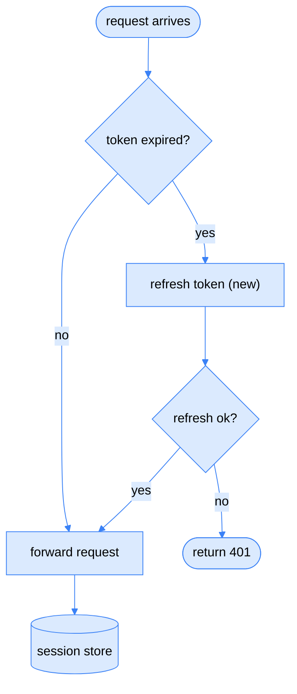
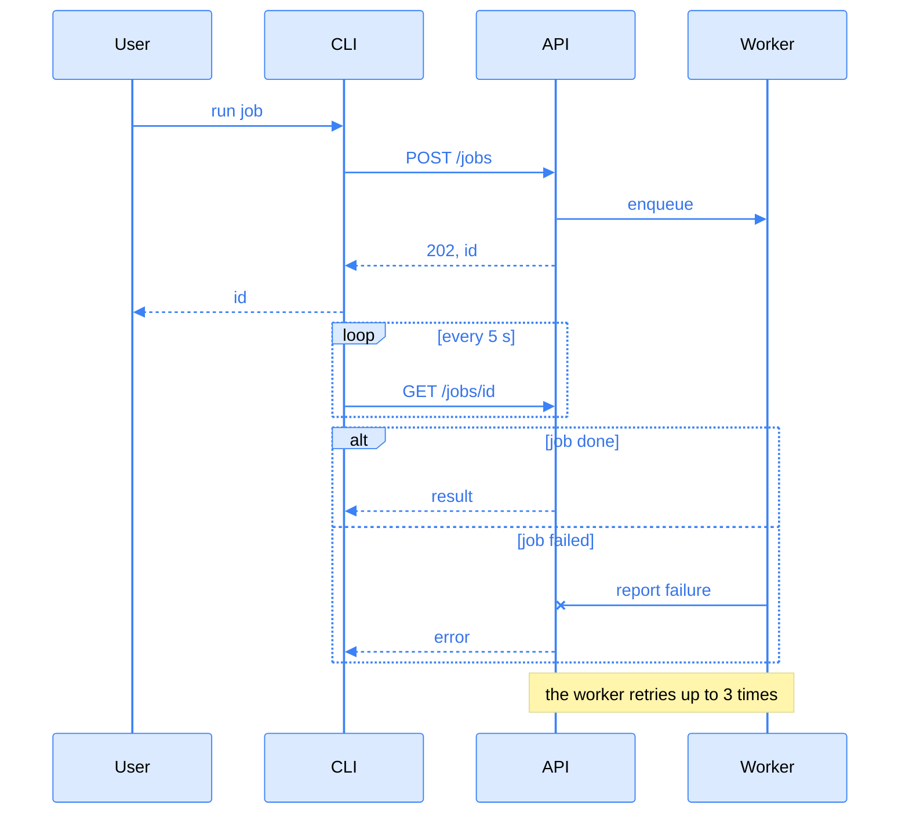
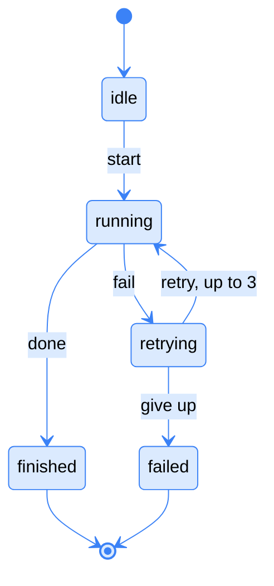
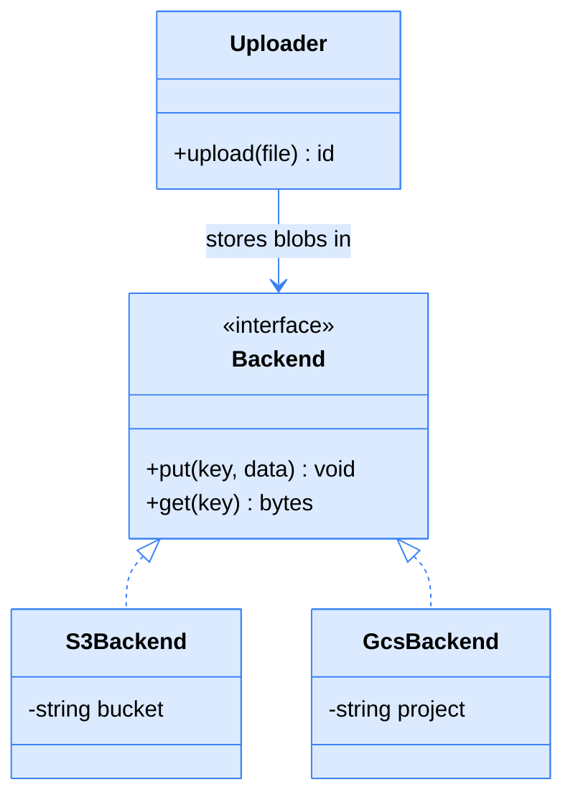
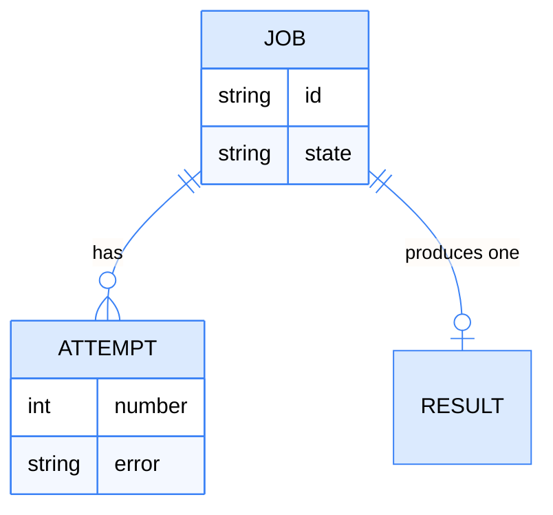

<!-- Generated by scripts/render-diagramize-preview.py. Edit docs/diagramize/*.mmd or plugins/explain/skills/diagramize/references/mermaid-*.json, not this file. -->

# diagramize preview

Each Mermaid kind as diagramize writes it in a Markdown file, with the settings from [`mermaid-light.json`](../../plugins/explain/skills/diagramize/references/mermaid-light.json). Text sits on light fills, except sequence messages and loop conditions, which use a mid blue that reads on light and dark pages. Each viewer draws the diagrams with its own Mermaid version, so details can differ. [`preview.html`](preview.html) shows the exact look of diagramize's HTML pages.

## flowchart

## sequence

## state

## class

## er

